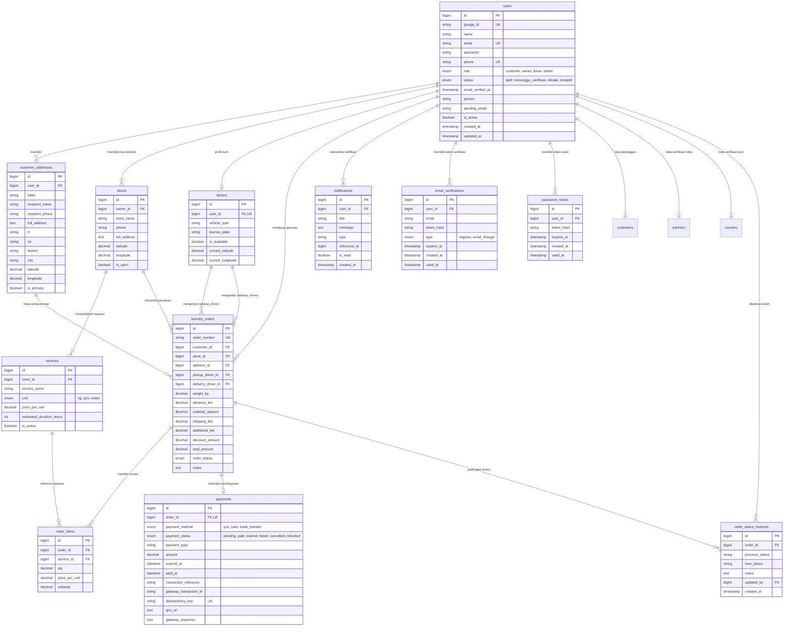

# 🗄️ DATABASE ARCHITECTURE & SCHEMA DOCUMENTATION

Dokumen ini mendokumentasikan skema basis data, relasi antar-entitas, indeks performa, aturan integritas referensial, dan kontrol transaksi pada database **Marketplace Laundry**.

---

## 🏗️ Spesifikasi Database

- **Database Engine**: MySQL 8.0+ / MariaDB 10.4+
- **Storage Engine**: `InnoDB` (Mendukung ACID Transactions & Row-Level Locking)
- **Character Set**: `utf8mb4`
- **Collation**: `utf8mb4_unicode_ci`
- **Nama Database**: `marketplace_laundry`

---

## 📊 Entity Relationship Diagram (ERD)

---

## 📋 Rincian Definisi Tabel

### 1. `users`
Menyimpan identitas seluruh aktor pengguna (Customer, Owner Toko, dan Kurir).
- `id`: BIGINT UNSIGNED AUTO_INCREMENT PRIMARY KEY.
- `google_id`: VARCHAR(255) NULL UNIQUE (ID akun dari Google OAuth).
- `name`: VARCHAR(150) NOT NULL.
- `email`: VARCHAR(150) NOT NULL UNIQUE (Indeks pencarian login).
- `password`: VARCHAR(255) NULL (Hashed password untuk login kredensial manual; NULL jika login Google).
- `phone`: VARCHAR(20) NULL.
- `role`: ENUM('customer', 'owner', 'driver') NOT NULL DEFAULT 'customer'.
- `is_active`: TINYINT(1) DEFAULT 1.
- `created_at` / `updated_at`: TIMESTAMP.

### 2. `customer_addresses`
Menyimpan alamat pelanggan lengkap dengan koordinat geospasial (Latitude & Longitude) dan unit RT/RW.
- `id`: BIGINT UNSIGNED AUTO_INCREMENT PRIMARY KEY.
- `user_id`: BIGINT UNSIGNED NOT NULL (FK ke `users.id` ON DELETE CASCADE).
- `label`: VARCHAR(50) DEFAULT 'Rumah'.
- `recipient_name`: VARCHAR(150) NOT NULL.
- `recipient_phone`: VARCHAR(20) NOT NULL.
- `full_address`: TEXT NOT NULL.
- `rt`: VARCHAR(10) NULL (Rukun Tetangga).
- `rw`: VARCHAR(10) NULL (Rukun Warga).
- `district`: VARCHAR(100) NULL (Kecamatan).
- `city`: VARCHAR(100) NULL (Kota/Kabupaten).
- `latitude`: DECIMAL(10, 8) NULL (Koordinat GPS Google Maps).
- `longitude`: DECIMAL(11, 8) NULL.
- `is_primary`: TINYINT(1) DEFAULT 0.

### 3. `stores`
Informasi cabang toko laundry fisik milik Owner.
- `id`: BIGINT UNSIGNED AUTO_INCREMENT PRIMARY KEY.
- `owner_id`: BIGINT UNSIGNED NOT NULL (FK ke `users.id` ON DELETE CASCADE).
- `store_name`: VARCHAR(150) NOT NULL.
- `phone`: VARCHAR(20) NULL.
- `full_address`: TEXT NOT NULL.
- `latitude` / `longitude`: DECIMAL (Titik acuan kalkulasi jarak pengiriman).
- `is_open`: TINYINT(1) DEFAULT 1.

### 4. `services`
Katalog layanan cucian per toko (Cuci Komplit, Kiloan, Bedcover, dll).
- `id`: BIGINT UNSIGNED AUTO_INCREMENT PRIMARY KEY.
- `store_id`: BIGINT UNSIGNED NOT NULL (FK ke `stores.id` ON DELETE CASCADE).
- `service_name`: VARCHAR(100) NOT NULL.
- `unit`: ENUM('kg', 'pcs', 'meter') DEFAULT 'kg'.
- `price_per_unit`: DECIMAL(12, 2) NOT NULL.
- `estimated_duration_hours`: INT UNSIGNED DEFAULT 24.
- `is_active`: TINYINT(1) DEFAULT 1.

### 5. `drivers`
Informasi kurir penjemputan dan pengantaran.
- `id`: BIGINT UNSIGNED AUTO_INCREMENT PRIMARY KEY.
- `user_id`: BIGINT UNSIGNED NOT NULL UNIQUE (FK ke `users.id` ON DELETE CASCADE).
- `vehicle_type`: VARCHAR(50) NOT NULL (Motor/Mobil).
- `license_plate`: VARCHAR(20) NOT NULL (Nomor Polisi kendaraan).
- `is_available`: TINYINT(1) DEFAULT 1.
- `current_latitude` / `current_longitude`: DECIMAL (Posisi kurir saat ini).

### 6. `laundry_orders`
Tabel transaksi utama pemesanan laundry.
- `id`: BIGINT UNSIGNED AUTO_INCREMENT PRIMARY KEY.
- `order_number`: VARCHAR(50) NOT NULL UNIQUE (Format: `ORD-YYYYMMDD-XXXX`).
- `customer_id`: BIGINT UNSIGNED NOT NULL (FK ke `users.id`).
- `store_id`: BIGINT UNSIGNED NOT NULL (FK ke `stores.id`).
- `address_id`: BIGINT UNSIGNED NOT NULL (FK ke `customer_addresses.id`).
- `pickup_driver_id`: BIGINT UNSIGNED NULL (FK ke `drivers.id`, kurir penjemput pakaian kotor).
- `delivery_driver_id`: BIGINT UNSIGNED NULL (FK ke `drivers.id`, kurir pengantar pakaian bersih).
- `weight_kg`: DECIMAL(8, 2) NULL DEFAULT 0.00 (Diisi saat proses penimbangan oleh Owner).
- `distance_km`: DECIMAL(8, 2) DEFAULT 0.00 (Jarak tempuh rute berkendara via Google Maps API).
- `shipping_fee`: DECIMAL(12, 2) DEFAULT 0.00 (Ongkir dinamis berbasis tiering jarak).
- `subtotal_amount`: DECIMAL(12, 2) DEFAULT 0.00 (`weight_kg * price_per_unit`).
- `total_amount`: DECIMAL(12, 2) DEFAULT 0.00 (`subtotal + shipping_fee`).
- `order_status`: ENUM status siklus pesanan:
  1. `pending_pickup`: Pesanan baru dibuat, menunggu alokasi kurir.
  2. `driver_assigned`: Kurir penjemputan telah ditugaskan oleh owner.
  3. `driver_on_the_way`: Kurir sedang dalam perjalanan ke alamat pelanggan.
  4. `arrived_at_customer`: Kurir tiba di depan rumah pelanggan.
  5. `picked_up`: Pakaian kotor telah diserahkan ke kurir.
  6. `arrived_at_store`: Pakaian tiba di toko laundry.
  7. `weighed`: Pakaian telah selesai ditimbang, invoice terbit.
  8. `waiting_payment`: Menunggu pembayaran QRIS atau konfirmasi Cash.
  9. `in_process`: Pembayaran terkonfirmasi, pakaian sedang dicuci/disetrika.
  10. `ready_for_delivery`: Laundry selesai diproses, siap diantarkan.
  11. `delivery_assigned`: Kurir pengantaran ditugaskan.
  12. `delivered`: Pakaian bersih berhasil diserahkan ke pelanggan.
  13. `completed`: Transaksi selesai sepenuhnya.
  14. `cancelled`: Pesanan dibatalkan (kadaluarsa bayar / pembatalan).

### 7. `order_items`
Rincian item layanan dalam pesanan laundry.
- `id`: BIGINT UNSIGNED AUTO_INCREMENT PRIMARY KEY.
- `order_id`: BIGINT UNSIGNED NOT NULL (FK ke `laundry_orders.id` ON DELETE CASCADE).
- `service_id`: BIGINT UNSIGNED NOT NULL (FK ke `services.id`).
- `qty`: DECIMAL(8, 2) NOT NULL DEFAULT 1.00.
- `price_per_unit`: DECIMAL(12, 2) NOT NULL.
- `subtotal`: DECIMAL(12, 2) NOT NULL.

### 8. `payments`
Pencatatan gateway pembayaran QRIS Midtrans & pembayaran tunai (CASH).
- `id`: BIGINT UNSIGNED AUTO_INCREMENT PRIMARY KEY.
- `order_id`: BIGINT UNSIGNED NOT NULL UNIQUE (Setiap order memiliki 1 record pembayaran; mencegah double invoice).
- `payment_method`: ENUM('qris', 'cash', 'bank_transfer') NOT NULL DEFAULT 'qris'.
- `payment_status`: ENUM('pending', 'paid', 'expired', 'failed', 'cancelled', 'refunded') NOT NULL DEFAULT 'pending'.
- `payment_type`: VARCHAR(50) NULL.
- `amount`: DECIMAL(12, 2) NOT NULL.
- `expired_at`: DATETIME NOT NULL (Masa kedaluwarsa 60 menit untuk QRIS; 7 hari untuk Cash).
- `paid_at`: DATETIME NULL.
- `transaction_reference`: VARCHAR(100) NULL (Order ID acuan ke Midtrans).
- `gateway_transaction_id`: VARCHAR(100) NULL.
- `idempotency_key`: VARCHAR(100) NULL UNIQUE (Pencegahan double-submit).
- `qris_url`: TEXT NULL (URL gambar QRIS Midtrans).
- `gateway_response`: JSON NULL (Payload utuh respons gateway).

### 9. `order_status_histories`
Audit log jejak perubahan status pesanan secara kronologis.
- `id`: BIGINT UNSIGNED AUTO_INCREMENT PRIMARY KEY.
- `order_id`: BIGINT UNSIGNED NOT NULL (FK ke `laundry_orders.id` ON DELETE CASCADE).
- `previous_status`: VARCHAR(50) NULL.
- `new_status`: VARCHAR(50) NOT NULL.
- `notes`: TEXT NULL.
- `updated_by`: BIGINT UNSIGNED NULL (User yang melakukan aksi).
- `created_at`: TIMESTAMP DEFAULT CURRENT_TIMESTAMP.

### 10. `notifications`
Sistem notifikasi in-app untuk pengguna.
- `id`: BIGINT UNSIGNED AUTO_INCREMENT PRIMARY KEY.
- `user_id`: BIGINT UNSIGNED NOT NULL (FK ke `users.id` ON DELETE CASCADE).
- `title`: VARCHAR(150) NOT NULL.
- `message`: TEXT NOT NULL.
- `type`: VARCHAR(50) DEFAULT 'order_update'.
- `reference_id`: BIGINT UNSIGNED NULL (ID pesanan terkait).
- `is_read`: TINYINT(1) DEFAULT 0.

---

## 🛡️ Aturan Transaksi & Kontrol Konkurensi

1. **ACID Transactions**:
   - Pembuatan pesanan (`createOrderTransaction`) menjalankan INSERT alamat, INSERT order, INSERT item, dan INSERT status history dalam 1 transaksi PDO atomik.
   - Jika salah satu query gagal, rollback otomatis dijalankan tanpa menyisakan data yatim (*orphan data*).
2. **Pencegahan Race Condition (`SELECT FOR UPDATE`)**:
   - Pemrosesan Webhook Midtrans dan Konfirmasi Cash menggunakan row lock `SELECT * FROM payments WHERE id = :id FOR UPDATE`. Thread kedua yang datang bersamaan akan menunggu hingga transaksi pertama selesai, lalu membaca status terkini (`paid`) dan melewati eksekusi (*idempotent skip*).
3. **Pemberitahuan Otomatis**:
   - Setiap transisi status di `Order::updateOrderStatusWithNotification` mencatat histori status dan secara otomatis menyisipkan notifikasi ke tabel `notifications` pelanggan.
