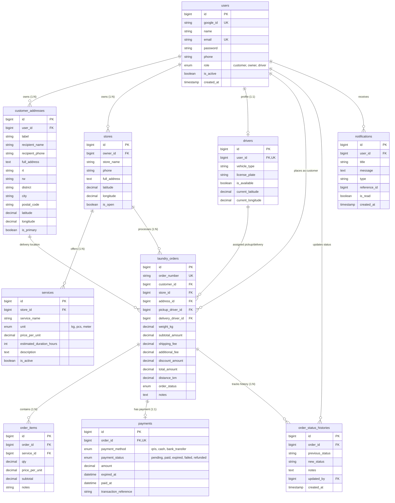

# Entity Relationship Diagram (ERD) - Marketplace Laundry

Dokumentasi rancangan basis data relational untuk aplikasi Marketplace Laundry.

## 📐 Mermaid ERD Diagram

---

## 📋 Penjelasan Entitas & Relasi Database

### 1. `users`
- **Deskripsi**: Entitas utama pengguna sistem.
- **Role**: `customer` (Pelanggan), `owner` (Pemilik Laundry), dan `driver` (Kurir).
- **Indeks**: `idx_users_role`, `idx_users_email`.

### 2. `customer_addresses`
- **Deskripsi**: Menyimpan daftar alamat pengiriman pelanggan. Pelanggan dapat memiliki lebih dari satu alamat (`is_primary` menandai alamat utama).
- **Relasi**: Foreign key `user_id` merujuk ke `users(id)` dengan `ON DELETE CASCADE`.

### 3. `stores`
- **Deskripsi**: Profil toko laundry yang dimiliki oleh pengguna berperan `owner`.
- **Relasi**: Foreign key `owner_id` merujuk ke `users(id)` dengan `ON DELETE CASCADE`.

### 4. `services`
- **Deskripsi**: Katalog layanan laundry yang ditawarkan oleh masing-masing toko (misal: Cuci Kiloan, Dry Clean).
- **Satuan (Unit)**: `kg`, `pcs`, `meter`.
- **Relasi**: Foreign key `store_id` merujuk ke `stores(id)` dengan `ON DELETE CASCADE`.

### 5. `drivers`
- **Deskripsi**: Profil kurir (Driver) untuk melakukan jemput/antar laundry.
- **Relasi**: Foreign key `user_id` merujuk ke `users(id)` secara unique (`1:1`).

### 6. `laundry_orders`
- **Deskripsi**: Entitas utama transaksi pemesanan laundry.
- **Nomor Order Unik**: Kolom `order_number` bertipe unique string (contoh: `ORD-20260902-XXXX`).
- **Alur Status (`order_status`)**:
  - `pending_pickup`
  - `pickup_assigned`
  - `picked_up`
  - `arrived_at_store`
  - `weighed`
  - `in_process`
  - `ready_for_delivery`
  - `delivery_assigned`
  - `delivered`
  - `completed`
  - `cancelled`

### 7. `order_items`
- **Deskripsi**: Rincian item/layanan yang dibeli dalam satu order.
- **Relasi**: Foreign key `order_id` ke `laundry_orders(id)` (`ON DELETE CASCADE`) dan `service_id` ke `services(id)`.

### 8. `payments`
- **Deskripsi**: Menyimpan status dan rincian transaksi pembayaran.
- **Batas Waktu Expiration**: Kolom `expired_at` (DATETIME) yang mencatat batas waktu pembayaran 1 jam.
- **Status Pembayaran**: `pending`, `paid`, `expired`, `failed`, `refunded`.

### 9. `order_status_histories`
- **Deskripsi**: Rekam jejak (*audit trail*) seluruh perubahan status order dari awal hingga selesai beserta catatan dan user yang melakukan pengubahan (`updated_by`).

### 10. `notifications`
- **Deskripsi**: Pesan notifikasi in-app untuk pengguna terkait pembaruan order.
